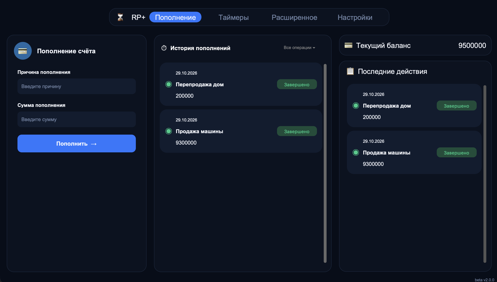

# 🕐 RP+

> Простое десктопное приложение для отслеживания пополнений и управления балансом.

---

## 📋 О проекте

**RP+** — это лёгкое и удобное приложение для учёта пополнений. Оно помогает отслеживать доходы, вести историю транзакций и всегда быть в курсе текущего баланса.

Приложение работает локально — **никакие данные не отправляются в интернет**. Всё хранится в файле `history.json` рядом с приложением.

---

## ✨ Возможности

- 💰 **Добавление пополнений** — с указанием причины и суммы.
- 📜 **История транзакций** — с датой, суммой и причиной.
- 📊 **Текущий баланс** — автоматический подсчёт.
- 🕐 **Последние действия** — быстрый доступ к последним операциям.
- 🌙 **Тёмная тема** — минималистичный дизайн.
- 💾 **Сохранение данных** — история не теряется при закрытии.
- 👋 **Приветственное окно** — при первом запуске.

---

## 🛠 Стек технологий

- **Python 3.14** — язык программирования.
- **CustomTkinter** — современный GUI-фреймворк.
- **Pillow** — работа с изображениями.
- **JSON** — хранение данных.

---

## 📦 Установка и запуск

1. Скачай последний релиз со страницы [Releases](../../releases).
2. Распакуй архив.
3. Запусти `RP+.exe`.

## 🚀 Использование

    Первый запуск — появится приветственное окно. Нажми «Начать».

    Добавление записи — введи причину и сумму, нажми «Пополнить».

    История — все записи отображаются в центре.

    Баланс — текущая сумма в правом верхнем углу.

    Навигация — переключайся между вкладками в шапке.

## 💙 Поддержать проект

    Если тебе нравится RP+, ты можешь поддержать разработку:

    https://img.shields.io/badge/Boosty-%D0%9F%D0%BE%D0%B4%D0%B4%D0%B5%D1%80%D0%B6%D0%B0%D1%82%D1%8C-ff6b00?style=for-the-badge&logo=buy-me-a-coffee

    Любая поддержка — мотивация делать приложение лучше!

## 📄 Лицензия

Этот проект распространяется под лицензией MIT. Подробнее — в файле LICENSE.

## 👤 Автор

AnSerpent

    GitHub: @AlexDark333

    Boosty: boosty.to/iserpent

## 🙏 Благодарности

    CustomTkinter — за красивый GUI.

    Pillow — за работу с изображениями.

    Всем, кто тестировал и оставлял фидбек. 💙